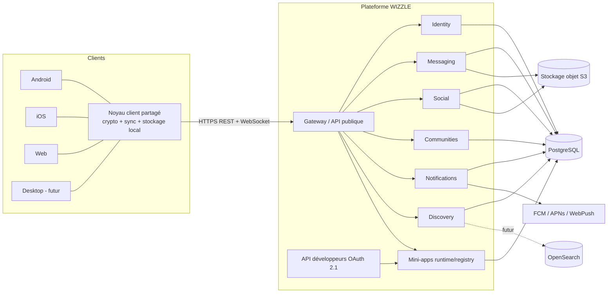
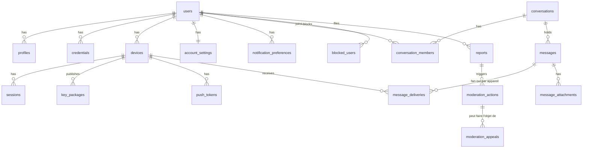

# WIZZLE — Plan d'exécution technique (Phase 0 / première mission)

> Statut : **proposition soumise à validation**. Aucun code produit tant que ce document n'est pas validé.
> Les chiffres (coûts, durées) sont des **estimations de planification** à confirmer, pas des engagements.
> Date : 2026-11-10 · Cahier des charges : v1.0

---

## 0. État du dépôt (constat)

- Dépôt vide : un commit initial, un fichier `LICENSE`. Aucun choix technique préexistant, rien à préserver.
- **Contradiction détectée** : `LICENSE` est *The Unlicense* (domaine public), alors que le cahier des charges impose une **licence propriétaire**. Tant que ce fichier reste tel quel, tout le code publié serait de fait du domaine public. **À corriger avant le premier commit de code** (décision n°1 ci-dessous).
- Outillage de la session : Rust (cargo 1.97), Node 22, Docker disponibles ; Flutter absent.

---

## 1. Analyse critique du projet

### 1.1 Ce qui est solide
- Vision cohérente, ordre de priorités sain (socle → messagerie → reste), refus explicite des microservices et de Kubernetes prématurés, cryptographie non maison.
- MVP ciblé sur l'identité + messagerie E2EE + multi-appareils : c'est le bon cœur.

### 1.2 Ce qui est irréaliste ou sous-estimé
1. **Le périmètre « super-app » est celui d'une grande entreprise.** Le MVP seul (E2EE multi-appareils + 3 plateformes + notifications + audit) représente un produit complet de messagerie sécurisée. Il faut accepter que *la super-app est une trajectoire de 3 à 5 ans*, pas un livrable.
2. **L'E2EE multi-appareils sur Web est le point le plus difficile** du MVP (stockage des clés dans le navigateur, intégrité du code JS servi, absence de stockage sécurisé). Voir §8.
3. **Trois plateformes dès le MVP + bootstrap** : sans équipe identifiée, c'est le principal risque de calendrier. La taille et les compétences de l'équipe ne sont **pas définies** dans le cahier des charges.
4. **« Aucun défaut critique ouvert » + audit indépendant** : un audit cryptographique coûte typiquement des dizaines de milliers d'euros (estimation à valider par devis) ; il doit être budgété dès maintenant.
5. **Métadonnées** : le cahier des charges traite le contenu mais pas les métadonnées (qui parle à qui, quand). Le serveur les verra forcément en MVP. Il faut l'assumer et le documenter honnêtement dans la politique de confidentialité (« le serveur ne lit pas le contenu » ≠ « le serveur ne sait rien »).

### 1.3 Contradictions et zones insuffisamment définies (à trancher, non inventées)

| # | Sujet | Problème | Proposition |
|---|-------|----------|-------------|
| C1 | Licence | `LICENSE` = domaine public vs « propriétaire » | Remplacer par un en-tête « All rights reserved » + `LICENSE` propriétaire rédigée/validée par un juriste |
| C2 | **Signal Protocol vs licence propriétaire** | `libsignal` (implémentation de référence) est sous **AGPL-3.0** : incompatible avec un produit propriétaire fermé sans accord de licence spécifique | Voir ADR-004 : MLS (OpenMLS, MIT) en candidat principal ; vodozemac (Apache-2.0) en alternative. **À valider par un juriste et un cryptographe** |
| C3 | E2EE vs recherche « dans les conversations » | Le serveur ne peut pas indexer du chiffré | Recherche **locale** sur l'appareil uniquement (index chiffré local) |
| C4 | E2EE vs signalement/modération | Le serveur ne peut pas vérifier un signalement | Le *signaleur* transmet volontairement le contenu signalé (+ preuve cryptographique de provenance, « message franking ») ; jamais d'accès administrateur direct |
| C5 | E2EE vs aperçus de liens, notifications riches, IA | Chaque fonction côté serveur casse le modèle | Aperçus générés côté expéditeur ; notifications = payload chiffré déchiffré sur l'appareil ; IA = locale ou consentement explicite par message |
| C6 | « Messages vocaux/médias » E2EE | Taille, stockage, quotas | Chiffrement côté client avant envoi, blob opaque en stockage objet, clé transmise dans le message E2EE |
| C7 | Communautés / réseau social vs E2EE | Les salons de communauté et publications sont **publics ou semi-publics, donc non E2EE** | À écrire explicitement : E2EE = messagerie privée et groupes privés ; communautés = chiffrées en transit/au repos uniquement |
| C8 | Date de naissance « si nécessaire » vs minimisation / mineurs | Règles mineurs (RGPD art. 8, DSA) non spécifiées | Collecter seulement un **âge déclaré / tranche** au MVP ; à valider juridiquement |
| C9 | Téléphone « facultatif » vs anti-abus | Sans téléphone, la création de comptes en masse est facile | E-mail vérifié + limitation de débit + preuve de travail/captcha respectueux ; téléphone optionnel |
| C10 | Profils multiples (perso/pro/créateur/organisation) vs E2EE | Une identité cryptographique par compte ou par profil ? Non défini | MVP : **un seul profil personnel**, schéma prêt pour plusieurs ; décision crypto avant d'activer le multi-profils |
| C11 | Pile technique (Redis, NATS, OpenSearch) vs « simplicité / faible coût » | Trois composants d'infrastructure de plus à exploiter | MVP : **PostgreSQL seul** + stockage objet. Redis/NATS/OpenSearch repoussés (ADR-006) |
| C12 | OIDC / OAuth 2.1 « authentification » | Un fournisseur OIDC complet n'est utile que pour les **tiers** (mini-apps) | MVP : sessions propriétaires ; OIDC provider en Phase 4 |
| C13 | Sauvegardes chiffrées « sous contrôle de l'utilisateur » | Mécanisme non défini (phrase de récupération ? fichier ? cloud perso ?) | Choix de design à faire en Lot 4 (voir §8.6) |
| C14 | Historique sur nouvel appareil | Non défini : un nouvel appareil voit-il l'historique ? | Par défaut **non** (sécurité) ; transfert appareil→appareil par QR en option, ou via sauvegarde |
| C15 | Mini-apps sur iOS | Règles App Store sur les « mini-apps » et le contenu exécuté dynamiquement | Étude de conformité Apple (guideline sur les mini-apps) avant Phase 4 |
| C16 | Nom « WIZZLE » | Proximité phonétique avec des marques existantes (ex. compagnie aérienne « Wizz Air ») : risque de confusion à **vérifier** | Recherche d'antériorités (classes 9, 38, 42, 45) avant tout investissement de marque |
| C17 | Hébergement | Aucune exigence de souveraineté/localisation | Proposition : hébergement UE (cohérent RGPD et positionnement) |
| C18 | Accessibilité | « Applicable » non précisé | Cible WCAG 2.2 AA ; European Accessibility Act à instruire |

---

## 2. Registre des risques

| ID | Risque | Probabilité | Impact | Mitigation |
|----|--------|:--:|:--:|-----------|
| R1 | Faille dans l'implémentation E2EE | M | Critique | Bibliothèques éprouvées uniquement, aucune primitive maison, revue spécialisée + audit externe avant bêta publique |
| R2 | Licence des bibliothèques crypto (AGPL) incompatible avec produit propriétaire | Élevée | Critique | ADR-004, avis juridique avant dépendance |
| R3 | E2EE Web non sûr (clés exfiltrées via XSS, code JS modifié) | M | Élevé | CSP stricte, SRI, pas de scripts tiers, stockage non extractible (WebCrypto), documenter la limite ; Web en « client de confiance moindre » au départ |
| R4 | Équipe insuffisante pour 3 plateformes | Élevée | Élevé | Cœur crypto/sync partagé en Rust (FFI/WASM), MVP Web possiblement décalé de quelques semaines |
| R5 | Notifications push vs E2EE (iOS notamment) | M | M | Notification Service Extension iOS, messages data-only Android ; contenu masqué par défaut |
| R6 | Synchronisation : doublons, trous, ordre | Élevée | Élevé | Protocole défini d'abord (ADR-007), idempotence, curseurs par appareil, tests de simulation (réseau instable) |
| R7 | Abus : spam, contenus illicites, CSAM | Élevée | Critique | Rate limiting, signalement, blocage, procédure de retrait, obligations DSA/hébergeur à instruire juridiquement avant le lancement |
| R8 | Conformité RGPD/DSA/mineurs | M | Élevé | DPO/juriste dès Phase 0, registre de traitements, analyse d'impact (AIPD) |
| R9 | Dérive de coûts (stockage médias, IA, push) | M | M | Quotas, expiration des médias, suivi mensuel, IA hors MVP |
| R10 | Dérive de périmètre (« super-app » dès le départ) | Élevée | Élevé | Règle : un module à la fois, critères de sortie par lot |
| R11 | Dépendance mono-fournisseur (push FCM/APNs, cloud) | M | M | Abstraction côté serveur, stockage S3-compatible, Docker portable |
| R12 | Perte de données / sauvegarde non restaurable | F | Critique | Test de restauration planifié à chaque lot, pas seulement en fin de MVP |
| R13 | Rust : recrutement et courbe d'apprentissage | M | M | Périmètre backend modeste, conventions strictes, CI (clippy, deny) |
| R14 | Marque : conflit juridique | M | Élevé | C16 |
| R15 | Exposition légale sur les demandes d'autorités | M | Élevé | Procédure documentée ; avec E2EE, seules les métadonnées sont disponibles — à écrire dans le rapport de transparence |

(Probabilité : F faible, M moyenne.)

---

## 3. Architecture cible (vision long terme)



Principes d'architecture :
1. **Monolithe modulaire** : un seul binaire, des modules aux frontières strictes ; extraction en service uniquement sur besoin mesuré.
2. **Les quatre espaces de confiance (§7.2 du cahier)** ont des modèles de permission distincts : messagerie privée E2EE ; social public ; communautés privées ; tiers.
3. **Les mini-apps ne voient jamais** messages privés ni clés : elles s'exécutent hors du processus et du domaine du client principal (iframe sandboxée sur domaine séparé / WebView isolée), via un pont à capacités explicites.
4. **Le client est l'autorité cryptographique** ; le serveur est un relais de blobs opaques + annuaire de clés publiques.

---

## 4. Architecture du MVP

Périmètre = §13.1 du cahier. Composants **strictement nécessaires** :

| Composant | MVP | Reporté |
|-----------|-----|---------|
| Backend Rust (monolithe modulaire) | ✅ | |
| PostgreSQL | ✅ (données, files de livraison, rate limiting, recherche utilisateur `pg_trgm`) | |
| Stockage objet S3-compatible (blobs chiffrés) | ✅ | |
| WebSocket (temps réel) | ✅ | |
| Push FCM/APNs/WebPush | ✅ | |
| Reverse proxy (Caddy) + Docker Compose | ✅ | |
| Redis | ❌ | quand le rate limiting/présence dépasse ce que Postgres/mémoire supportent |
| NATS JetStream | ❌ | multi-instance ou extraction de services |
| OpenSearch | ❌ | recherche publique avancée (Phase 4) |
| Social, communautés, appels, mini-apps, paiements, IA | ❌ | voir roadmap |

Modules MVP : `identity`, `messaging`, `media`, `notifications`, `safety` (blocage, signalement), `platform` (audit, flags, config).

---

## 5. Frontend — comparatif et recommandation

Critères du cahier : rendu Web, performances, accessibilité, notifications, audio/vidéo, natif, poids, maintenance — **plus un critère non listé mais décisif : le partage du noyau crypto/sync**.

| Option | Mobile | Web | Accessibilité Web | Partage de code | Risque |
|--------|:--:|:--:|:--:|:--:|--------|
| **A. Flutter partout** | Très bon | Moyen : rendu canvas, bundle lourd (~2 Mo+ de moteur), SEO/accessibilité limités, intégration navigateur (autofill, passkeys, sélection de texte) plus délicate | Faible à moyen | Maximal (UI + logique) | Web de qualité inférieure ; E2EE Web via WASM/JS à intégrer |
| **B. Flutter mobile + React/TS Web** | Très bon | Très bon : DOM natif, a11y, SEO pages publiques, Web Crypto | Bon | Design tokens + noyau Rust (FFI / WASM) ; UI dupliquée | Deux UI à maintenir |
| **C. React Native + React Web** | Bon | Bon | Bon | Logique TS commune | Crypto : ponts natifs ; perfs d'UI de messagerie moins homogènes ; écosystème Expo ok |
| **D. Natif (Kotlin/Swift) + Web TS** | Excellent | Très bon | Excellent | Faible (noyau Rust seul) | Coût de 3 bases de code : irréaliste en bootstrap |
| **E. Tauri/Capacitor (WebView)** | Moyen | Très bon | Bon | Maximal | Perfs/UX mobile, WebView et E2EE sensibles |

**Recommandation (sous réserve d'un prototype jetable de 1–2 semaines, voir Lot 0)** : **Option B**.
- **Pourquoi** : le Web est la plateforme où l'accessibilité, les passkeys, le SEO des pages publiques (profils, communautés) et la taille comptent le plus ; Flutter Web y est le plus faible. Le mobile est là où Flutter apporte le plus.
- **Clé de voûte** : un **noyau client en Rust** (chiffrement MLS, machine d'état de synchronisation, modèles) exposé via `flutter_rust_bridge` (mobile) et WASM (Web). Une seule implémentation du protocole = une seule surface à auditer. Cela réutilise aussi la compétence Rust déjà requise côté serveur.
- **Alternative si l'équipe est de 1 à 2 personnes** : Option A pour livrer plus vite, en acceptant un Web dégradé au départ, et réévaluer. Le noyau Rust rend ce choix réversible.
- **Conséquence** : design system défini en **tokens** (JSON) consommés par Flutter et par le Web, pas en composants partagés.

Pas de décision définitive avant le prototype : critères mesurables (poids initial, FPS liste de 10 000 messages, déchiffrement WASM, lecteur d'écran, notifications iOS déchiffrées).

---

## 6. Architecture Rust détaillée

### 6.1 Workspace Cargo (monolithe modulaire)

```
backend/
├── Cargo.toml                  # workspace
├── crates/
│   ├── wizzle-server/          # binaire : composition, config, démarrage
│   ├── wizzle-api/             # Axum : routes, extracteurs, OpenAPI (utoipa), WebSocket
│   ├── wizzle-core/            # types de domaine, erreurs, IDs, traits partagés (sans I/O)
│   ├── wizzle-identity/        # comptes, profils, sessions, appareils, passkeys, MFA
│   ├── wizzle-messaging/       # conversations, livraison chiffrée, reçus, sync
│   ├── wizzle-media/           # URLs pré-signées, quotas, métadonnées de blobs
│   ├── wizzle-notifications/   # préférences, jetons push, envoi
│   ├── wizzle-safety/          # blocages, signalements, actions de modération
│   ├── wizzle-platform/        # audit, feature flags, rate limiting, config
│   └── wizzle-db/              # migrations SQLx, pool, helpers de transaction
└── (plus tard : discovery, social, communities, miniapps)
client-core/
└── crates/
    ├── wizzle-client-crypto/   # enveloppe autour de la lib MLS retenue
    ├── wizzle-client-sync/     # file d'envoi, curseurs, reprise, déduplication
    └── wizzle-client-ffi/      # bindings Dart (FRB) et WASM
```

Règles de modularité (vérifiées en CI via `cargo deny`/tests d'architecture) :
- Un module n'importe que `wizzle-core` et l'**interface publique** (traits) des autres modules ; jamais leurs tables.
- **Un schéma PostgreSQL par module** (`identity.*`, `messaging.*`…) ; pas de jointure inter-schémas → extraction future facilitée. Les références inter-modules se font par ID, sans clé étrangère au-delà de l'identité.
- `unsafe` interdit hors `client-ffi` (`#![forbid(unsafe_code)]`).

### 6.2 Choix et réserves sur la pile proposée

| Élément | Décision | Raison / réserve |
|---------|----------|------------------|
| Axum + Tokio + Serde | ✅ | Standard de fait, maintenu, licences MIT |
| SQLx | ✅ | Requêtes vérifiées à la compilation, migrations ; ORM inutile |
| REST + WebSocket | ✅ | WebSocket pour la livraison ; REST pour le reste |
| OpenAPI | ✅ via `utoipa` | Spéc générée depuis le code, contrat testé en CI |
| Hachage mots de passe | **Argon2id** (crate `argon2`), paramètres OWASP ; pepper côté serveur | Cahier : « mécanisme moderne ». OPAQUE envisageable plus tard |
| Passkeys | `webauthn-rs` | Mûr ; à valider sur mobile (Credential Manager / iOS) |
| Jetons | Jeton d'accès court + **refresh token rotatif opaque** lié à l'appareil, stocké haché | Révocation à distance simple, détection de réutilisation |
| OIDC / OAuth 2.1 | Reporté (Phase 4) | Utile aux tiers uniquement |
| Rate limiting | `tower` + compteurs en mémoire/PostgreSQL | Redis plus tard |
| Observabilité | `tracing` + OpenTelemetry (export OTLP) ; Prometheus ; Grafana/Loki auto-hébergés ou léger | |
| Erreurs | `thiserror` dans les bibliothèques, enveloppe d'erreur API stable (RFC 9457 Problem Details) | |
| Qualité | `clippy -D warnings`, `rustfmt`, `cargo deny` (licences + vulnérabilités), `cargo audit` | Vérification des licences = exigence du cahier §17 |

### 6.3 Protocole de synchronisation et temps réel (ADR-007, à écrire en premier)
- Le serveur attribue un **numéro de séquence monotone par appareil destinataire** (`delivery_seq`). Chaque appareil mémorise son dernier curseur acquitté.
- L'envoi est **idempotent** via `client_message_id` (UUID généré par le client) ; le serveur déduplique.
- WebSocket : `hello(cursor)` → rattrapage depuis le curseur → flux temps réel ; `ack(seq)` ; battements ; reconnexion avec backoff + gigue.
- Repli HTTP long-polling/REST `GET /sync?since=` pour résilience et tests.
- Le serveur conserve le message chiffré **jusqu'à acquittement de tous les appareils actifs** (ou expiration), puis le supprime : le serveur n'est pas l'archive.
- Présence et « en train d'écrire » : éphémères, jamais persistés.

### 6.4 Identité, appareils, sessions
- Un **compte** (`users`) → un ou plusieurs **appareils** (`devices`), chacun avec sa session et ses clés publiques.
- Ajout d'appareil : approbation depuis un appareil déjà connecté (QR / code) ; notification de sécurité sur tous les appareils ; liste et révocation à distance.
- Récupération de compte : ne doit **jamais** restituer l'historique chiffré (sauf sauvegarde utilisateur).

---

## 7. Schéma initial de base de données (MVP)

Ne contient **que** les tables des lots 1 à 7. Les tables social/communautés/mini-apps du cahier (§11) viendront avec leurs modules.
Conventions : identifiants UUIDv7, `timestamptz` UTC, suppression logique uniquement où la rétention légale l'exige, sinon suppression réelle (RGPD).



Tables et points clés :

| Table | Rôle | Contraintes / index notables |
|-------|------|------------------------------|
| `users` | Compte | `public_handle` unique insensible à la casse (citext), e-mail unique haché pour la recherche + chiffré, `status`, `deleted_at` |
| `profiles` | Profil (MVP : 1 personnel) | `kind` (personal/…), `visibility`, FK `user_id` ; unicité `(user_id, kind)` au MVP |
| `credentials` | Mot de passe (Argon2id), passkeys, TOTP | `type`, secret haché/chiffré, jamais en clair ; index `(user_id, type)` |
| `devices` | Appareil | `identity_key_pub`, `platform`, `last_seen_at`, `revoked_at` |
| `sessions` | Sessions | `refresh_token_hash`, `device_id`, `expires_at`, `revoked_at`, détection de réutilisation |
| `key_packages` | Matériel public MLS à usage unique | consommation atomique (`FOR UPDATE SKIP LOCKED`), nettoyage des expirés |
| `conversations` | Conversation | `kind` (direct/group), `mls_group_id`, métadonnées minimales côté serveur |
| `conversation_members` | Appartenance | `role`, `joined_at`, `left_at`, unique `(conversation_id, user_id)` |
| `messages` | **Enveloppe opaque** | `ciphertext bytea`, `sender_device_id`, `client_message_id` unique par expéditeur, `created_at` ; **aucun texte en clair** |
| `message_deliveries` | File par appareil destinataire | `delivery_seq` monotone, `acked_at` ; index `(device_id, delivery_seq)` ; purge après ack |
| `message_attachments` | Référence de blob chiffré | `object_key`, `size`, `expires_at`, jamais la clé de déchiffrement |
| `message_receipts` | Reçus (configurables) | transportés comme messages chiffrés ; table seulement si nécessaire |
| `blocked_users` | Blocage | PK `(blocker_id, blocked_id)` ; appliqué côté serveur à la création de conversation/livraison |
| `reports` / `moderation_actions` / `moderation_appeals` | Signalement et traçabilité | contenu signalé fourni volontairement par le signaleur ; rétention bornée |
| `push_tokens`, `notification_preferences` | Notifications | unique `(device_id, provider)` |
| `account_settings` | Confidentialité (reçus de lecture, visibilité) | |
| `audit_events` | Événements de sécurité | append-only ; pas de contenu de message ; rétention définie (par ex. 12 mois, à valider juridiquement) |
| `feature_flags`, `system_settings` | Configuration | |

Stratégies transverses (à détailler dans `DATABASE.md`) :
- **Suppression de compte** : purge des credentials, appareils, jetons, files de livraison ; anonymisation ou purge des signalements selon délais légaux.
- **Rétention** : messages livrés supprimés du serveur après ack ; médias expirants ; audit borné.
- **Politiques d'accès** : accès applicatif uniquement via un rôle PostgreSQL à droits minimaux ; **Row-Level Security** en défense en profondeur sur les tables par utilisateur ; l'autorisation principale reste dans le code (vérifiée côté serveur).
- Migrations SQLx versionnées, **forward-only**, testées sur base vide et sur copie de base.

---

## 8. Stratégie de chiffrement E2EE

> Toute cette section est une **proposition à faire valider par un cryptographe** avant implémentation. Aucune primitive n'est écrite par WIZZLE.

### 8.1 Choix du protocole — ADR-004

| Option | Atouts | Limites |
|--------|--------|---------|
| **Signal Protocol (`libsignal`)** | Référence, très éprouvé, forward secrecy + post-compromise security | **AGPL-3.0** : incompatible avec un produit propriétaire fermé sauf accord de licence ; groupes via *sender keys* (moins de PCS) ; multi-appareils à construire |
| **MLS (RFC 9420) via OpenMLS** | Standard IETF ; **groupes natifs efficaces** (arbre) ; multi-appareils naturel (un appareil = une feuille) ; licence permissive (MIT) | Écosystème plus jeune, moins d'audits publics que Signal ; complexité (commits, ordonnancement par le serveur) |
| **Olm/Megolm (`vodozemac`)** | Apache-2.0, audité (Matrix), pratique | Megolm : sécurité de groupe plus faible (pas de PCS) ; moins standard |
| Protocole maison | — | **Interdit par le cahier** |

**Recommandation : MLS via OpenMLS** pour conversations directes (groupe de 2) *et* de groupe, un seul chemin de code. Conditions préalables : (a) audit de la bibliothèque et de l'intégration, (b) maturité des bindings WASM/mobile à valider au Lot 0, (c) avis juridique sur les licences. Repli : vodozemac. Si la licence AGPL de libsignal est acceptable (accord ou publication du code), Signal redevient candidat — c'est une décision business/juridique, pas technique.

### 8.2 Rôle du serveur
- **Annuaire de clés publiques** (key packages) et **relais ordonné** de messages MLS (le serveur sert d'« autorité de livraison » pour l'ordre des commits).
- Il ne détient aucune clé privée, aucun secret de groupe, aucun texte en clair.
- Les administrateurs n'ont techniquement aucun accès au contenu.

### 8.3 Modèle d'identité et d'appareils
- Un appareil = une identité cryptographique (clé de signature) générée **sur l'appareil**, clé privée dans le stockage sécurisé (Keychain / Keystore / WebCrypto non extractible).
- Ajout/retrait d'appareil = *Add/Remove* MLS dans tous les groupes du compte ; notification de sécurité.
- **Vérification** : numéro de sécurité / QR comparables entre utilisateurs ; avertissement lors de changement de clé (pas de remplacement silencieux).

### 8.4 Médias
Chiffrement côté client (AES-256-GCM, clé aléatoire par fichier), envoi du blob chiffré vers S3 par URL pré-signée, clé + empreinte transmises **dans le message E2EE**. Le serveur ne voit que taille et date.

### 8.5 Notifications push
Le serveur envoie un push **sans contenu** (ou chiffré) : iOS via Notification Service Extension qui déchiffre localement, Android via message de données. Par défaut : « Nouveau message », sans expéditeur ni texte, option utilisateur pour afficher l'aperçu local.

### 8.6 Sauvegardes et récupération
- Perte de tous les appareils = **perte de l'historique**, sauf sauvegarde chiffrée optionnelle.
- Pistes (à trancher, C13) : clé de récupération de 24 mots, ou fichier chiffré exporté vers le stockage de l'utilisateur. Aucune sauvegarde lisible par WIZZLE.

### 8.7 Ce que l'E2EE ne couvre pas (à publier honnêtement)
Métadonnées (identités, horaires, tailles, graphe social), mineure fuite via notifications, sécurité de l'appareil de l'utilisateur, **sécurité réduite du client Web** (intégrité du code servi). Le Web pourra être livré avec un niveau d'assurance explicitement documenté.

### 8.8 Validation
Vecteurs de test officiels, tests de propriété/fuzzing du parseur de messages, revue interne dédiée, puis **audit externe avant toute bêta ouverte** (budget à prévoir).

---

## 9. Organisation du dépôt (adaptée)

Le plan du cahier est conservé dans son esprit, avec trois ajustements : `backend/` devient un **workspace Cargo** (pas des services séparés) ; un `client-core/` partagé Rust apparaît ; les dossiers de modules futurs ne sont **créés que lorsqu'ils sont utilisés**.

```
wizzle/
├── apps/
│   ├── mobile/          # Flutter (Android/iOS)
│   └── web/             # React + TypeScript
├── backend/             # workspace Cargo (voir §6.1)
├── client-core/         # noyau Rust partagé (crypto, sync) + bindings
├── packages/
│   ├── design-tokens/   # source de vérité des couleurs/typo (JSON)
│   ├── api-client/      # clients générés depuis OpenAPI
│   └── shared-models/   # générés, pas écrits à la main
├── infrastructure/{docker,deployment,monitoring,backups}/
├── documentation/{architecture,product,api,database,security,decisions}/
├── tests/{integration,security,e2e,load}/
├── LICENSE              # à remplacer (propriétaire)
├── README.md CLAUDE.md ARCHITECTURE.md DATABASE.md API.md
└── SECURITY.md ROADMAP.md CONTRIBUTING.md CHANGELOG.md
```
`apps/desktop/` et les modules `social`, `communities`, `discovery`, `miniapps` n'existent pas encore volontairement.

---

## 10. Plan de tests

| Niveau | Contenu | Outils | Quand |
|--------|---------|--------|-------|
| Unitaires | Domaine, validation, autorisations | `cargo test`, `proptest` | Chaque commit |
| Intégration | API + vraie PostgreSQL + S3 local | `testcontainers`, `sqlx` | Chaque PR |
| Contrat API | Conformité OpenAPI ↔ implémentation | schéma généré + `schemathesis`/équivalent | Chaque PR |
| Crypto | Vecteurs officiels, fuzzing, propriétés (ordre, rejeu, perte) | `cargo-fuzz`, `proptest` | Chaque PR (rapide) + nuit |
| Sync | Simulation réseau : coupures, doublons, réordonnancement, multi-appareils | harnais déterministe de simulation | Chaque PR |
| E2E | Parcours complets 2 clients | Playwright (Web), `integration_test` (Flutter) | Nuit + avant release |
| Sécurité | SAST, `cargo audit/deny`, scan de secrets, ZAP (DAST), authz « test négatif » (accès à la conversation d'autrui) | outils CI | Chaque PR / hebdo |
| Charge | Connexions WebSocket, débit de messages, p95 < 300 ms | `k6` | Avant bêta puis régulier |
| Résilience | Restauration de sauvegarde chronométrée | script + runbook | **À chaque lot**, pas seulement en fin de MVP |
| Accessibilité | axe-core, lecteurs d'écran, WCAG 2.2 AA | manuel + auto | Avant bêta |
| Externes | Test d'intrusion + audit crypto indépendants | prestataires | Avant bêta ouverte |

Règle : le code d'autorisation et de crypto a une barre de couverture et de revue **plus élevée** que le reste.

---

## 11. Plan d'infrastructure à faible coût

### 11.1 Cible de lancement
- **1 à 2 VPS Linux en UE** (ex. fournisseurs européens type Hetzner/Scaleway/OVH — comparaison de prix et de conditions à faire avant choix) : application Rust + PostgreSQL + Caddy (TLS automatique) en Docker Compose.
- **Stockage objet S3-compatible UE** pour médias chiffrés (quotas, expiration).
- Sauvegardes PostgreSQL chiffrées (WAL + dump quotidien) vers un autre fournisseur/région ; **test de restauration planifié**.
- CI/CD : GitHub Actions → image Docker → déploiement par SSH/`docker compose pull`. Environnements : dev local (compose), staging, production.
- Secrets : variables chiffrées (SOPS/age) ou gestionnaire du fournisseur ; **jamais dans le dépôt**.
- Observabilité : Prometheus + Grafana + Loki sur la même machine au début ; alertes e-mail/push.

### 11.2 Ordres de grandeur (à confirmer par devis réels)
| Poste | Estimation mensuelle |
|-------|----------------------|
| Dev/staging | ≈ 20–60 € |
| Production bêta (1–2 VPS, base, sauvegardes) | ≈ 60–200 € |
| Stockage objet + sorties réseau | variable, quasi nul au départ ; **surveiller** (médias = poste dominant) |
| Push FCM/APNs | gratuit |
| Comptes développeur | Apple ≈ 99 $/an ; Google Play ≈ 25 $ une fois |
| Un audit crypto + un test d'intrusion | **ponctuel, plusieurs dizaines de milliers d'euros** (devis requis) — le plus gros poste du MVP |
| Juridique (RGPD/DSA/marque/CGU) | ponctuel, devis requis |

### 11.3 Passage à l'échelle (déclencheurs, pas échéances)
Réplica lecture PostgreSQL → Redis si présence/limiteur saturent → NATS si plusieurs instances → extraction du module le plus chargé. Kubernetes seulement si l'exploitation multi-nœuds le justifie.

---

## 12. Roadmap détaillée par lots

Durées **non fournies** : elles dépendent de la taille de l'équipe (inconnue). Chaque lot a un **critère de sortie** vérifiable et laisse l'application exécutable.

| Lot | Contenu | Critère de sortie |
|-----|---------|-------------------|
| **0 — Cadrage & prototypes** | ADR 001–008 ; décision licence ; avis juridique (licences crypto, marque, RGPD/DSA) ; **spike crypto** (OpenMLS 2 clients, natif + WASM) ; **spike front** (Flutter vs Web) ; design tokens + logo | Décisions signées ; spikes concluants ou plan B choisi |
| **1 — Fondations** | Workspace, CI (fmt/clippy/test/deny/audit), Docker Compose, migrations, config, logs/traces, `/health`, OpenAPI | `docker compose up` démarre ; CI verte ; premier déploiement staging |
| **2 — Identité** | Inscription e-mail + vérification, Argon2id, sessions/refresh rotatif, appareils, déconnexion à distance, MFA TOTP, passkeys, profil, rate limiting, audit de sécurité, export/suppression de compte | Parcours testés E2E ; tests d'autorisation négatifs ; restauration de sauvegarde testée |
| **3 — Messagerie 1:1 E2EE** | Key packages, conversations directes, relais, protocole de sync + simulation réseau, clients minimaux (CLI de test puis UI) | Deux appareils échangent des messages chiffrés avec coupures/doublons simulés |
| **4 — Multi-appareils & groupes** | Ajout/retrait d'appareil, groupes MLS, vérification de clés, sauvegarde utilisateur (décision C13) | Un compte sur 3 appareils ; groupe de N membres ; rotation de clés testée |
| **5 — Médias & notifications** | Blobs chiffrés, quotas, push masqués, préférences par catégorie/appareil | Média E2EE de bout en bout ; push iOS/Android sans fuite de contenu |
| **6 — Sûreté & vie privée** | Blocage, signalement avec preuve, paramètres de confidentialité, recherche d'utilisateurs, politiques de rétention | Tous les points §19 « blocage / paramètres » opérationnels |
| **7 — Clients complets** | Android, iOS, Web (parallélisables dès le Lot 3), accessibilité, i18n FR/EN | Parcours MVP complet sur 3 plateformes |
| **8 — Durcissement & bêta fermée** | Tests de charge, pentest, **audit crypto indépendant**, corrections, runbooks sauvegarde/restauration, analyse juridique de lancement | Aucun défaut critique ouvert (cahier §19) |
| **9 — Lancement UE** | Stores, déploiement Web, support, supervision, CGU/confidentialité | Critères §19 intégralement cochés |
| **Ensuite** | Appels (WebRTC/SFU) → social → communautés → recherche avancée → mini-apps/SDK → paiements (prestataire agréé) → IA | Un module à la fois, chacun avec son propre cahier de lot |

Parallélisation raisonnable : clients (Lot 7) démarrent dès que le protocole du Lot 3 est stable ; juridique et design courent en continu.

---

## 13. Registre des décisions à produire (ADR)

| ADR | Sujet | État proposé |
|-----|-------|--------------|
| 001 | Monolithe modulaire (workspace Cargo, schémas par module) | Proposé |
| 002 | PostgreSQL seul au MVP (Redis/NATS/OpenSearch reportés) | Proposé |
| 003 | Frontend : Flutter mobile + React Web + noyau Rust partagé | Proposé, **sous réserve du spike** |
| 004 | Protocole E2EE : MLS/OpenMLS (repli vodozemac) ; **licence AGPL de libsignal** | Proposé, **validation crypto + juridique** |
| 005 | Authentification : sessions propriétaires + Argon2id + passkeys ; OIDC en Phase 4 | Proposé |
| 006 | Hébergement UE, VPS + Docker Compose, pas de Kubernetes | Proposé |
| 007 | Protocole de synchronisation (curseurs par appareil, idempotence) | À écrire en premier |
| 008 | Licence du dépôt (propriétaire) et gestion des licences de dépendances | **À décider avant tout code** |

---

## 14. Décisions et informations dont j'ai besoin de vous

1. **Équipe** : combien de personnes, quels profils (Rust, mobile, Web, sécurité) ? Cela détermine le calendrier et l'option front (A ou B).
2. **Licence** : confirmez que le `LICENSE` actuel (domaine public) doit être remplacé par un régime propriétaire (je ne rédige pas de licence juridique : à valider par un juriste).
3. **Crypto** : acceptez-vous MLS/OpenMLS comme piste principale, avec avis juridique et cryptographe avant implémentation ?
4. **Budget** : enveloppe pour audit crypto, pentest et conseil juridique ?
5. **Hébergement** : UE obligatoire pour vous ? préférence de fournisseur ?
6. **Marque** : une recherche d'antériorité du nom WIZZLE est-elle lancée ?
7. **Périmètre Web du MVP** : acceptez-vous un Web livré légèrement après mobile, avec niveau d'assurance E2EE documenté ?

## 15. Prochaines étapes proposées (après votre validation)

1. Corriger la licence, créer `README.md`, `CLAUDE.md`, `SECURITY.md`, `ROADMAP.md`, `CONTRIBUTING.md`, `CHANGELOG.md`, `ARCHITECTURE.md`, `DATABASE.md`, `API.md` (squelettes honnêtes).
2. Rédiger les ADR 001–008.
3. Lot 0 : spikes crypto et front (code jetable, isolé dans un dossier `spikes/`).
4. Lot 1 : fondations exécutables.
